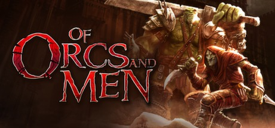

**Of Orcs and Men is the RPG following an Orc warrior and Goblin rogue on a suicidal assassination mission against the human emperor. Features a pause-and-play combat system and explores typical fantasy tropes from the monsters' perspective.**

---

## 📖 About

Of Orcs and Men is the RPG following an Orc warrior and Goblin rogue on a suicidal assassination mission against the human emperor. Features a pause-and-play combat system and explores typical fantasy tropes from the monsters' perspective.

## ⚠️ Problems Without Trainer

| Problem | Status |
|---------|--------|
| **Stamina Management** — Depleted stamina leaves characters nearly defenseless in combat | ✅ Solved |
| **Stealth Sections** — Arkail's stealth attempts with a massive orc body are mechanically limited | ✅ Solved |
| **Regeneration Timing** — Triggering regeneration at wrong moments wastes the ability entirely | ✅ Solved |
| **Short Campaign** — Main story completable in 8-10 hours with limited side content | ✅ Solved |

## ✅ Solution

The **Of Orcs and Men Trainer** solves all these issues by giving you complete control over the game.

## 🎯 Full Feature List

- Unlimited Resources
- God Mode / Invincibility
- Instant Skill Cooldown
- One-Hit Kill
- Freeze Game Timer
- Unlock All Items & Achievements
- Custom Speed Multiplier
- Save State Anywhere

## 🚀 Quick Start

1. **Disable Windows Defender** temporarily (trainer may trigger false positive)
2. Download the trainer from the button above
3. Launch Of Orcs and Men
4. Run the trainer as Administrator
5. Activate desired cheats with hotkeys

## 💎 Free vs Paid

| Feature | Free | Pro |
|---------|------|-----|
| Basic God Mode | ✅ | ✅ |
| Unlimited Resources | ✅ | ✅ |
| All Advanced Cheats | ❌ | ✅ |
| Auto-Updates | ❌ | ✅ |
| Priority Support | ❌ | ✅ |

## 💻 Requirements

- Windows 10/11 (64-bit)
- Of Orcs and Men (any version)
- .NET Framework 4.8+
- DirectX 11+

## 🍎 macOS

macOS users can use our alternative tool:

## ⚖️ Legal

This trainer is for educational and single-player use only. Use responsibly.

---

